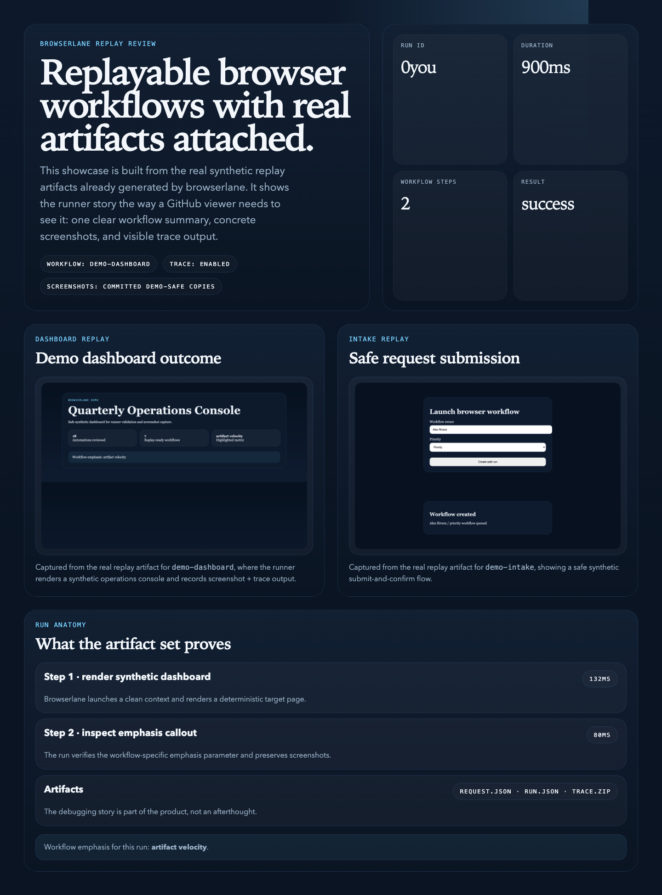

# Browserlane

`browserlane` is a secure browser workflow runner for developers and agent systems that need authenticated Playwright execution, structured run logs, and replayable example flows.

It is designed as a standalone product: teachable architecture, fully synthetic examples, and a clean adaptation path for people who want to build their own browser workflows without inheriting brittle site-specific logic or machine-specific deployment assumptions.



Showcase capture built from the committed replay artifacts, including the synthetic workflow screenshots that ship with the repo.

## Status

The current release focuses on a small but credible execution core.

What already exists:
- authenticated workflow execution over HTTP
- a shared Chromium process with isolated per-run contexts
- structured run artifacts with screenshots and Playwright traces
- two synthetic example workflows
- replay fixtures that rerun safe examples locally
- CI, security, and contributing baselines

## Product Direction

### Core promise
Turn fragile browser automations into a repeatable execution layer with authentication, isolated browser contexts, structured artifacts, and a sane debugging story.

### Intended users
- developers building internal browser automations
- agent builders who need a safe downstream browser executor
- technical PMs and founders prototyping browser-driven workflows

### What v1 is meant to include
- authenticated workflow execution over HTTP
- a shared browser process with isolated contexts per run
- structured workflow logs and saved artifacts
- safe local demo workflows with no private credentials
- a replayable debugging path

### What v1 is not meant to include
- institution-specific or single-tenant automations
- single-machine or tunnel-specific deployment setup
- copied selectors, HARs, cookies, or site credentials
- a giant library of brittle site-specific scripts

## Quick Start

```bash
cp .env.example .env
npm install
npx playwright install chromium
npm run replay:fixture -- demo/replays/demo-dashboard.json
```

That one command path proves the full browser-backed execution model and writes artifacts into `artifacts/runs/`.

To run the HTTP service locally after that:

```bash
npm run dev
```

Useful follow-up commands:

```bash
npm run test
npm run verify:demo
npm run replay:fixture -- demo/replays/demo-intake.json
npm run token
npm run check
```

## Example Workflows

| Workflow | What it demonstrates | Replay fixture |
| --- | --- | --- |
| `demo-dashboard` | Render-and-inspect pattern against a synthetic operations dashboard | `demo/replays/demo-dashboard.json` |
| `demo-intake` | Submit-and-verify pattern against a synthetic request form | `demo/replays/demo-intake.json` |

Each replay writes:
- `request.json`
- `run.json`
- step screenshots
- `trace.zip`

## Repo Structure

```text
src/
  Runner service, auth, workflow registry, and logging modules

scripts/
  Developer utilities and replay entry points

tests/
  Auth, execution, and artifact-recording unit coverage

demo/
  Demo-safe assets, poster files, and future example artifacts

docs/
  Architecture, launch, and safety notes
```

Key docs:
- `docs/architecture.md`
- `docs/replay-model.md`
- `docs/public-safety-review.md`
- `docs/release-readiness.md`
- `docs/roadmap.md`

## Implementation Map

- runner service
  Fastify-based HTTP entry point for workflow execution.
- auth layer
  Bearer-token verification and request gating.
- browser orchestration
  Shared browser lifecycle and isolated per-run contexts.
- workflow modules
  Public-safe example flows registered through a documented contract.
- logging and replay
  Structured artifacts, screenshots, and reproducible debug runs.

## Customization Guide

If someone wants to adapt `browserlane` for personal or team use, the intended flow is:

1. Run the built-in demo workflows locally.
2. Copy an example workflow instead of modifying the core service.
3. Replace the synthetic HTML/page source with their own safe target.
4. Adjust auth policy and artifact retention for their environment.
5. Extend the replay/debugging path before adding more workflows.

Expected customization points:
- auth issuer/audience/secret configuration
- workflow registry entries
- browser context defaults
- artifact directory and retention strategy
- replay fixtures and workflow-specific params

Recommended adaptation sequence:
1. Replay one of the built-in fixtures.
2. Duplicate `src/workflows/demo-intake.ts` or `src/workflows/demo-dashboard.ts`.
3. Replace the synthetic HTML generator with your own safe target page.
4. Add a new fixture under `demo/replays/`.
5. Keep the artifact output and trace capture path intact until your workflow is stable.

## Privacy Model

The public repo is designed around synthetic workflows and generic infrastructure.

Safe to expose:
- the authenticated runner architecture
- workflow lifecycle and logging shape
- demo-safe screenshots and artifacts
- local example flows against synthetic pages

Must stay out of the repo:
- real URLs, selectors, cookies, or tokens
- screenshots from private sites
- copied HAR files from private systems
- machine-specific deployment config

## For Claude / Codex

This repo is meant to be adaptable with an AI coding agent.

Read these files first:
- `README.md`
- `package.json`
- `src/server.ts`
- `src/runtime/execute-workflow.ts`
- `src/runtime/workflow-recorder.ts`
- `src/workflows/registry.ts`
- `src/workflows/demo-dashboard.ts`
- `src/workflows/demo-intake.ts`
- `demo/README.md`
- `docs/replay-model.md`

Safest places to start changing the repo:
- example workflows
- artifact/logging configuration
- auth and local-runner configuration
- the README and docs

What is intentionally missing:
- any real site selectors, cookies, or login flows
- any tunnel, launchd, or always-on deployment setup
- any customer-specific or single-tenant automations

## OSS Baseline

- License: Apache-2.0
- Security policy: [SECURITY.md](SECURITY.md)
- Contribution guide: [CONTRIBUTING.md](CONTRIBUTING.md)
- CI: `.github/workflows/ci.yml`
- Demo assets: [demo/README.md](demo/README.md)

## Verification

These are the checks used during pre-release verification:
- `npm run test`
- `npm run typecheck`
- `npm run lint`
- `npm run build`
- `npm run verify:demo`
- `npm run replay:fixture -- demo/replays/demo-dashboard.json`
- `npm run replay:fixture -- demo/replays/demo-intake.json`

## Launch Notes

Before wider launch:
- review [docs/public-safety-review.md](docs/public-safety-review.md)
- confirm [docs/release-readiness.md](docs/release-readiness.md)
- add a repository social preview using `demo/browserlane-social-preview.svg`
